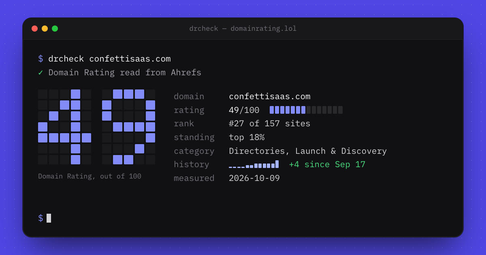

# drcheck

A website's Domain Rating from your terminal: the rating, its rank on
[domainrating.lol](https://domainrating.lol), its category and its history.

```sh
npx drcheck confettisaas.com
```



## What it does

`drcheck` asks domainrating.lol about a domain and prints the same figures the
site's "The Terminal" share graphic draws:

| line       | what it is                                                                                            |
| ---------- | ----------------------------------------------------------------------------------------------------- |
| `rating`   | the [Ahrefs Domain Rating](https://ahrefs.com/website-authority-checker), out of 100                  |
| `rank`     | its position among every site on the domainrating.lol ranking                                         |
| `standing` | its percentile, when it is in the top half                                                            |
| `category` | the category it is filed under                                                                        |
| `history`  | every daily reading as a sparkline, and the rise since the first; left out until the rating has moved |
| `measured` | the day the rating was read                                                                           |

### Domains that are not listed yet

If the domain is not on domainrating.lol, `drcheck` lists it there:

1. It checks that the name has a DNS `A` or `AAAA` record (falling back to
   `www.`), so only real websites get listed.
2. domainrating.lol reads the site and its Open Graph tags, drafts the
   listing's title, description and category from the page, and reads the
   Domain Rating from Ahrefs.
3. The listing goes on the ranking **locked**: its card is blurred and its
   outbound link is `nofollow`.

The output ends with the listing's page. Whoever runs the site can claim it
there, and unlock it with a one-off payment or for free with a badge.

Pass `--no-create` to only look a domain up.

### Full screen

```sh
npx drcheck confettisaas.com --full
```

`--full` turns the check into a screen of its own, like the share graphic's
window: the title along the top, the output centred, and the rating drawn at
double size when the terminal has room. It reads the rating again every hour
and says when it last did and when it will next. `r` refreshes now, `q`, `Esc`
or `Ctrl+C` quits, and your terminal comes back as it was.

## Usage

```
npx drcheck <domain> [options]

Options
  --full        Full screen, refreshed every hour (r refreshes, q quits)
  --json        Print the raw result as JSON
  --no-create   Only look the domain up; never list it
  -v, --version Print the version
  -h, --help    Print this help
```

The domain can be typed as `example.com`, `www.example.com` or a full URL; it
is normalised to the bare hostname.

### Environment

| variable          | effect                                                        |
| ----------------- | ------------------------------------------------------------- |
| `NO_COLOR`        | turn colour off ([no-color.org](https://no-color.org))        |
| `FORCE_COLOR`     | force colour on: `1` (16 colours), `2` (256), `3` (truecolor) |
| `DRCHECK_API_URL` | talk to another server (default `https://domainrating.lol`)   |

Colour is off when stdout is not a terminal, so piping gives plain text. The
progress spinner goes to stderr and only on a terminal.

### Exit codes

| code  | meaning                                                           |
| ----- | ----------------------------------------------------------------- |
| `0`   | printed a result                                                  |
| `1`   | the domain could not be checked or listed (the reason is printed) |
| `2`   | the command line was wrong                                        |
| `130` | interrupted                                                       |

### JSON

`--json` prints what the API answered:

```json
{
  "domain": "confettisaas.com",
  "created": false,
  "listing": {
    "slug": "confettisaas-com",
    "url": "https://domainrating.lol/tool/confettisaas-com",
    "locked": false,
    "claimable": false
  },
  "rating": {
    "dr": 49,
    "drLabel": "49",
    "rank": 27,
    "total": 157,
    "category": "Directories, Launch & Discovery",
    "measuredOn": "2026-10-09",
    "history": [
      { "on": "2026-09-17", "dr": 45 },
      { "on": "2026-10-09", "dr": 49 }
    ],
    "change": { "delta": 4, "since": "2026-09-17" }
  }
}
```

`rating` is `null` when Ahrefs has no rating for the domain yet. `created` is
`true` only on the run that listed it.

## Privacy

`drcheck` sends the domain you typed to domainrating.lol, with a
`drcheck/<version>` user agent. Nothing else: no telemetry, no config files, no
runtime dependencies.

## Development

```sh
pnpm install
pnpm dev confettisaas.com     # run from source
pnpm test
pnpm build                    # dist/cli.js
```

Against a local domainrating.lol:

```sh
DRCHECK_API_URL=https://domainrating.localhost NODE_EXTRA_CA_CERTS=~/.portless/ca.pem pnpm dev example.com
```

## Releasing

1. Bump `version` in `package.json` and commit.
2. Tag it: `git tag v0.1.1 && git push --tags`.
3. The `release` workflow tests, builds and publishes to npm with provenance,
   through npm trusted publishing (no token in the repo).

The very first version is published by hand (`npm publish`), because npm only
lets you add a trusted publisher to a package that exists. After that, add
this repository and `release.yml` as the trusted publisher in the package's
settings on npmjs.com.

## License

MIT
